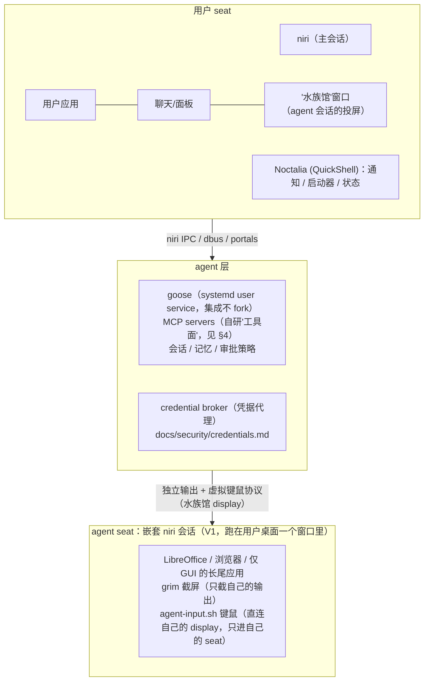

# 架构设计

> 状态：v0.1 草案（2026-10）。随开发推进持续修订，重大变更记录在文末“变更记录”。

## 1. 愿景与产品形态

用户只与 agent 对话。agent 通过 OS 级工具面完成工作，并自主决定结果的呈现方式：

- **外发格式**（docx/pptx/xlsx/pdf）：生成文件，调起 LibreOffice / WPS 展示；
- **agent 原生内容**：生成式 UI（HTML/React → canvas 窗口），进 artifacts 库可随时回看；
- **异步事件**：桌面通知（Noctalia 通知中心）。

产品差异化不在“再做一个 agent 框架”，而在三件别人没做完整的事：

1. **人机并发会话**——agent 拥有自己的 GUI 会话，操作电脑不打扰用户；
2. **OS 级工具面**——agent 的主力通道是系统 IPC 与无障碍树，不是截图+鼠标；
3. **信任机制**——凭据“可用不可读”、分级确认、审计回放、快照回滚。

## 2. 总体形态



## 3. 人机并发模型（核心设计决策）

**结论：虚拟桌面做不到人机并发，agent 必须拥有独立 compositor 会话。**

### 3.1 为什么虚拟桌面不行

虚拟桌面属于同一会话，共享同一个 seat（键盘鼠标焦点）。任意时刻全会话只有一个
“获得焦点的 surface”：

- agent 注入的输入（ydotool → /dev/uinput）落在**当前活跃桌面**，会打进用户正在用的窗口；
- agent 要操作别的桌面就必须切换前台，用户的屏幕会翻页、焦点被抢。

这与是否平铺式窗口管理器无关，Windows/macOS 同理。

### 3.2 分阶段实现独立会话

| 阶段 | 方案 | 说明 |
|---|---|---|
| V1（M3） | **嵌套 niri**：agent 会话跑在用户桌面一个窗口里（“水族馆”） | niri 官方支持嵌套运行；输入天然隔离在窗口内；用户可围观 agent 操作；实现成本最低 |
| V2 | **headless 虚拟输出 + 串流**（wayvnc/Sunshine） | agent 会话离屏渲染，不占桌面；需要时串流观看 |
| V3 | **真·多 seat**（第二物理屏 + udev seat 标签的 uinput 设备） | 输入并行已在 V1 达成（§3.3）；V3 剩余价值只是**输出**物理隔离，按需再做 |

关键收益：agent 截图永远只截**自己的输出**，不存在“用户屏幕被发给云端模型”的隐私问题。

### 3.3 输入注入选型（2026-10-25 更新：真并行成立）

- **agent 会话内输入（真并行，首选注入路径）**：水族馆是完整 compositor，自己的 display
  上同样暴露 `zwp_virtual_keyboard_v1` 与 `zwlr_virtual_pointer_v1`——wtype / wlrctl
  **直连水族馆 display**，注入只进嵌套 seat，与人的主 seat 键鼠互不干扰（结构保证）。
  封装 `scripts/agent-input.sh`。实测与证据见 [capabilities.md](capabilities.md) 附录 E；
- **主 seat 输入兜底**（agent 必须操作用户桌面窗口时）：uinput tablet 绝对坐标
  （`scripts/mouse-click.sh`，2026-10-19 根治）与 wtype（`scripts/kb-inject.sh`）——作用于
  主 seat，需“聚焦目标→注入→还原”三步走；
- GNOME 的 libei/portal 路径更合规但生态不覆盖我们；
- 进阶（V3）：自研受控 uinput 守护，将虚拟设备 udev 打标到第二物理 seat，实现输出级隔离。

## 4. 工具面：computer use 是兜底，不是主通道

纯视觉+鼠标的 GUI 操作是最贵、最慢、最脆的通道。分层如下，上层能解决就不下沉：

| 层 | 通道 | 内容 |
|---|---|---|
| L0 | 系统 IPC/API | `niri msg`（JSON + 事件流）、xdg-open、portals/dbus、通知、剪贴板（wl-clipboard+cliphist）、音频（wpctl/MPRIS）、NetworkManager、systemd、pacman |
| L1 | **AT-SPI2 无障碍树** | 结构化读取/触发 GTK/Qt/Electron/Chromium/LibreOffice 的 UI 元素（对齐微软 UFO 用 UIA 的思路）。确定性、零 token、零截图 |
| L2 | 浏览器自动化 | CDP 系（browser-use 等） |
| L3 | 视觉 computer use | 截图+指针，仅在 L0–L2 都不可用时，且只作用于 agent 自己的会话 |

产品叙事：**agent 快，是因为它大部分操作根本不走 GUI**。

## 5. 呈现层

- **artifacts 仓库**：`~/Agent/works/<task-id>/`，所有任务产物落盘、索引、可回看；
- **canvas**：本地 HTTP 服务 + webview 窗口，agent 生成 HTML/React，WebSocket 增量更新；niri 窗口规则自动摆位；
- **office 链路**：`xdg-open` 调起 LibreOffice/WPS + 窗口规则；
- **异步通知**：dbus 通知 → Noctalia 通知中心，附“点击查看产物”动作。

## 6. agent 引擎集成策略

- goose 以 **systemd user service** 常驻，聊天 UI / QuickShell 面板是其客户端；
- 工具面全部做成**自研 MCP servers** 挂给 goose，不 patch goose 核心——上游升级零成本；
- 需要深度体验（如 agent 直接消费 niri 事件流）时再以 PR 形式回馈上游。

## 7. 底座与发行

> 2026-10-17 更新：基座已定案 Fedora，完整决策依据见 [decisions/0001-base-distribution.md](decisions/0001-base-distribution.md)。

- **Tier 1 基座**：Fedora Workstation（开发/验证/文档主线，dnf 环境）；
- **CachyOS/Arch**：社区变体（install.sh 与 system-mcp 的 pacman 分支保留双支持）；
- **发行（M5）**：默认方向 **Fedora Atomic（bootc/OCI 镜像，Bazzite 模式）**——host 不可变、
  原子更新、失败自动回滚，契合"agent 误操作可回滚"的信任架构；过渡期保留
  "Workstation + meta-package + 一键安装脚本"路径（Omarchy 模式）；
- btrfs + snapper（或 Atomic 自带回滚）：agent 系统级变更前自动快照，支持一键回滚。

### 7.1 架构支持策略

| 层级 | 架构 | 约定 |
|---|---|---|
| **Tier 1（主线，唯一承诺）** | x86_64 (amd64) | 桌面主流所在；M5 的 ISO/meta-package 只出 x86_64；CI 与回归以 x86_64 为准 |
| **Tier 2（冒烟，best-effort）** | aarch64 (arm64) | 用于 Apple Silicon 虚拟机上的功能验证（macOS 虚拟机只能跑 arm64）。不进发行，不为 ARM 特判代码，遇到原生组件缺失记录即可 |

依据：CachyOS 无官方 aarch64 镜像（计划中等 Arch Linux ARM 上游），ARM 冒烟走
Fedora aarch64（niri 在其官方仓库）；goose 官方二进制含 arm64；我们自身的 TS/Node
代码天然跨架构。aarch64 真正的角色是**未来的第二物理形态**（ARM 笔记本/一体机），
届时再评估升 Tier。

## 8. 安全总纲

- **权限分级**：文件读写/开应用→免批；装软件/改配置→portal/polkit 确认；删数据/改系统→强确认；
- **凭据**：credential broker 代理，明文永不进入 agent 上下文（详见
  [security/credentials.md](security/credentials.md)）；
- **审计**：agent 每步操作结构化落日志；agent 会话可录屏（gpu-screen-recorder）回放；
- **回滚**：snapper 快照 + “撤销 agent 的操作”。

## 9. 仓库结构规划

```
AgentOS/
├── docs/                    # 设计文档（本目录）
├── packages/                # MCP servers 与 agent 侧组件（npm workspaces）
│   ├── niri-mcp/            # niri IPC：窗口/工作区/动作（M0）
│   ├── desktop-mcp/         # xdg-open/通知/剪贴板/portal（M1）
│   ├── system-mcp/          # systemd/pacman 只读+白名单动作（M1）
│   ├── files-mcp/           # 限定工作区的文件操作（M1）
│   ├── atspi-mcp/           # AT-SPI2 无障碍树桥（M3）
│   └── canvas/              # 呈现层本地服务（M2）
├── os/                      # 发行物：meta-package、安装脚本、archiso 配置（M5）
└── session/                 # agent 会话管理：嵌套 niri、输入注入、录屏（M3）
```

命名与归属随里程碑调整，文档即事实源。

## 10. 测试策略

- 单测全部走**注入的 fake runner**（命令不真跑），macOS 上可完整开发；
- MCP server 冒烟测试用 SDK 的 `InMemoryTransport` 起 client↔server 对；
- 真机（Linux/niri）验证放在每阶段收尾，形成“macOS 开发 + Linux 回归”节奏。

## 变更记录

- 2026-10-12 v0.1 初稿：定底座（CachyOS+niri+goose）、并发模型（独立会话）、分层工具面、呈现层与安全总纲。
- 2026-10-25 §3.3 更新：水族馆 display 虚拟键鼠协议实测——agent 键鼠真并行成立
  （不需要上游多 seat），“借道聚焦”降级为主 seat 兜底。证据见 capabilities.md 附录 E。
